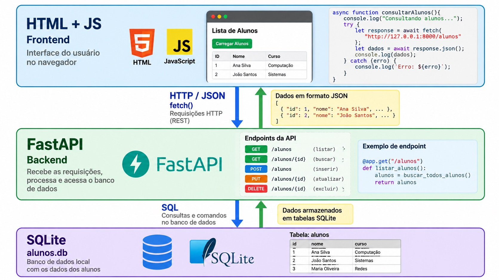
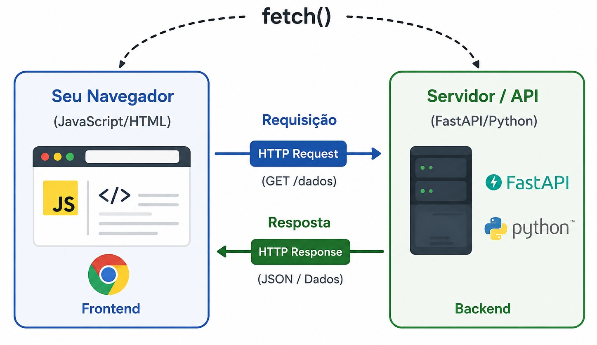
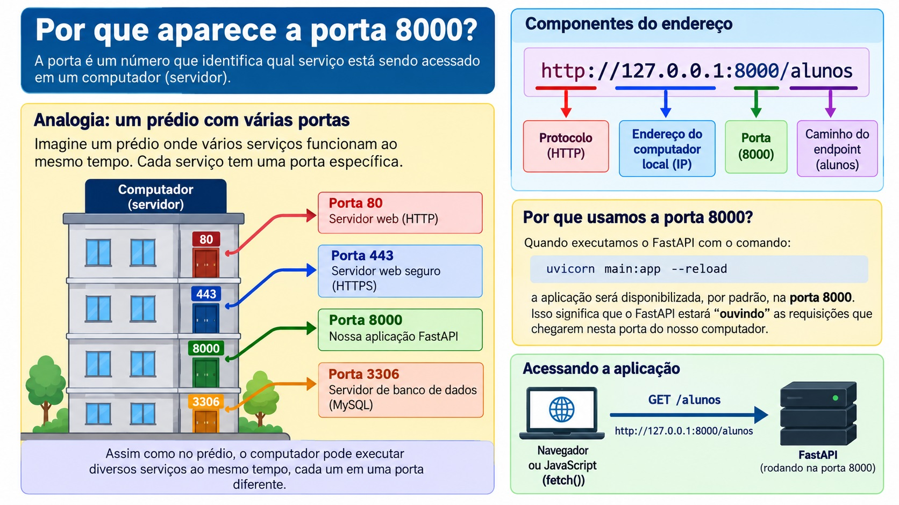
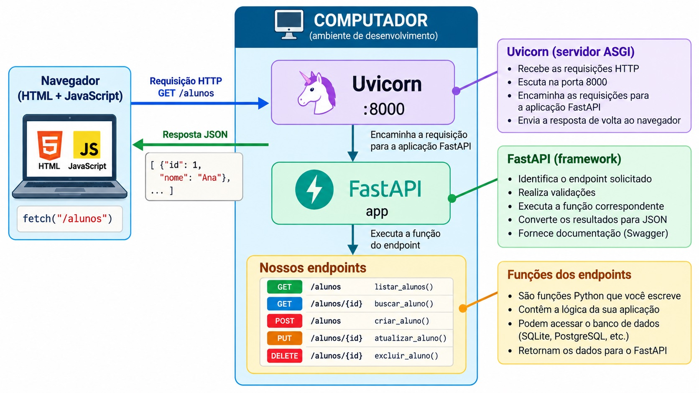
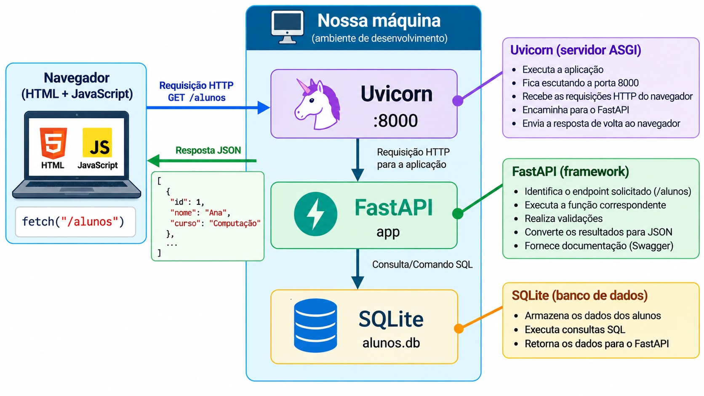
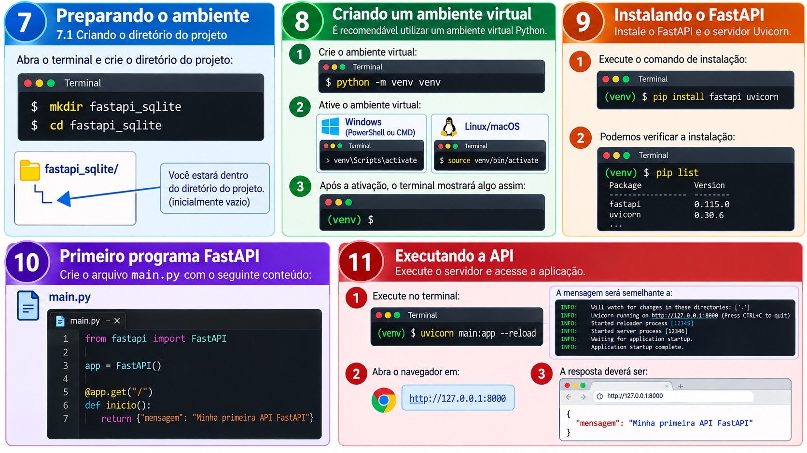

# FastAPI + SQLite + JavaScript `fetch()`

## Material didático introdutório

**Público-alvo:** alunos sem experiência prévia com FastAPI\
**Pré-requisitos:** noções básicas de Python, HTML e JavaScript\
**Objetivo:** construir uma API REST com FastAPI para consultar e
alterar dados armazenados em SQLite e consumi-la com JavaScript usando
`fetch()` e `async/await`.

------------------------------------------------------------------------

# 1. Objetivos de aprendizagem

Ao terminar este material, o aluno deverá ser capaz de:

-   compreender o conceito de API;
-   compreender a comunicação HTTP entre cliente e servidor;
-   criar uma aplicação básica com FastAPI;
-   executar uma aplicação FastAPI localmente;
-   criar endpoints HTTP;
-   utilizar os métodos `GET`, `POST`, `PUT` e `DELETE`;
-   receber parâmetros de rota;
-   receber query parameters;
-   receber dados JSON no corpo de uma requisição;
-   utilizar modelos Pydantic;
-   criar e consultar um banco SQLite;
-   implementar operações CRUD;
-   tratar erros HTTP;
-   testar uma API utilizando o Swagger/OpenAPI;
-   consumir uma API FastAPI utilizando JavaScript;
-   utilizar `fetch()`, `async`, `await`, `try/catch` e
    `response.json()`;
-   separar minimamente backend, banco de dados e frontend.

------------------------------------------------------------------------

# 2. Visão geral do projeto

Durante a apostila será construído um pequeno sistema de cadastro de
alunos.

A arquitetura será:



O navegador será o **cliente**.

O FastAPI será o **servidor/API**.

O SQLite será o **banco de dados**.

------------------------------------------------------------------------

# 3. O que é o fetch()?

Imagine que você é um garçom em um restaurante. <br> 
Você não cozinha a comida — você **leva o pedido para a cozinha e traz o resultado de volta** para o cliente. <br>
O `fetch()` é exatamente esse garçom no mundo do JavaScript. <br>

Em termos técnicos, o `fetch()` é uma função nativa do JavaScript (não precisa instalar nada!) que permite ao seu código de frontend (HTML/JS) **fazer requisições HTTP** para servidores, APIs e backends — como o nosso backend FastAPI.<br>




A resposta pode ser qualquer coisa: uma lista de tarefas, dados de um usuário, uma imagem, etc. <br>
No nosso caso, o servidor sempre nos responde com **JSON** (um formato de dado parecido com objetos JavaScript).<br>

#### Vamos praticar.<br>
Copie e cole o codigo abaixo no **https://www.onlinegdb.com/**<br>
Nao esqueça de selecionar a linguagem **HTML, CSS, JS**. <br>
Apos abrir o site, clique em **Language** e selecione **HTML, CSS, JS**. 


```html
<!DOCTYPE html>
<html lang="pt-BR">
<head>
  <meta charset="UTF-8">
  <title>Consulta CEP</title>
</head>
<body>
  <h2>Consulta CEP</h2>

  <input type="text" id="cep" placeholder="Ex: 01001000">
  <button onclick="buscarCep()">Buscar</button>

  <div id="resultado"></div>

  <script>
            async function buscarCep() {
              const cep = document.getElementById('cep').value;
              const resultado = document.getElementById('resultado');
        
              resultado.textContent = 'Carregando...';
        
              try {
                    const response = await fetch(`https://viacep.com.br/ws/${cep}/json/`);
                    const data     = await response.json();
        
                    if (data.erro) {
                      resultado.textContent = 'CEP não encontrado.';
                      return;
                    }
        
                    resultado.textContent = `CEP: ${data.cep}
                                            Logradouro: ${data.logradouro}
                                            Bairro: ${data.bairro}
                                            Cidade: ${data.localidade}
                                            UF: ${data.uf}`;
              } catch (erro) {
                    resultado.textContent = 'Erro na consulta.';
              }
            }
  </script>
</body>
</html>
```
# 4. Da API pública à nossa própria API

Até este momento, você já utilizou o `fetch()` para **consumir uma API que foi criada por outra pessoa ou empresa**.

No exemplo da consulta de CEP, utilizamos:

```javascript
const response = await fetch(
    `https://viacep.com.br/ws/${cep}/json/`
);
```

Observe atentamente o endereço:

```text
https://viacep.com.br/ws/13563892/json/
```

Esse endereço pertence a um **servidor que está na Internet**.

Nós não criamos esse servidor.

Nós apenas fazemos uma requisição para ele e recebemos os dados.

Agora vamos dar um passo importante:

> **Em vez de apenas consumir uma API criada por terceiros, vamos aprender a criar nossa própria API.**

---

## 4.1 API pública e nossa API

Até agora, nosso fluxo era:

```text
Nossa página HTML + JavaScript
              │
              │ fetch()
              ▼
        API pública
        ViaCEP
              │
              ▼
            JSON
```

Ou seja, nós somos apenas o **cliente** da API.

No projeto desta apostila, vamos construir o servidor:

```text
Nossa página HTML + JavaScript
              │
              │ fetch()
              ▼
          FastAPI
        nossa API
              │
              ▼
           SQLite
```

Agora nós teremos dois papéis:

```text
CLIENTE
   │
   │ JavaScript / fetch()
   ▼
SERVIDOR
   │
   │ FastAPI
   ▼
BANCO DE DADOS
   │
   │ SQLite
```

Essa é uma mudança importante.

Antes, você sabia apenas como **pedir dados para uma API**.

Agora você aprenderá também como **criar a API que fornece esses dados**.

---

# 4.2 O endereço de uma API

Observe novamente o endereço utilizado no ViaCEP:

```text
https://viacep.com.br/ws/13563892/json/
```

Podemos dividir esse endereço em partes:

```text
https://
    │
    └── protocolo

viacep.com.br
    │
    └── servidor/domínio

/ws/13563892/json/
    │
    └── caminho utilizado pela API
```

Quando fazemos:

```javascript
fetch(
    `https://viacep.com.br/ws/${cep}/json/`
);
```

estamos dizendo:

> "Faça uma requisição HTTP para este servidor, utilizando este caminho."

---

# 4.3 O que é um endpoint?

Agora vamos introduzir uma palavra que será muito utilizada nesta apostila:

> **endpoint**

Um endpoint é um **ponto de acesso da API**.

Por exemplo, uma API de usuários poderia possuir:

```text
GET /usuarios
```

Esse é um endpoint para obter usuários.

Também poderia possuir:

```text
GET /usuarios/10
```

Esse endpoint poderia ser utilizado para consultar o usuário de ID 10.

Outro endpoint poderia ser:

```text
POST /usuarios
```

utilizado para criar um novo usuário.

Portanto, uma API pode possuir vários endpoints.

---

# 4.4 API não é a mesma coisa que endpoint

Essa distinção é importante.

Considere:

```text
https://api.exemplo.com/usuarios
```

Podemos pensar em:

```text
https://api.exemplo.com
        │
        └── API / servidor

/usuarios
        │
        └── endpoint
```

Ou seja:

> **A API é o serviço que disponibiliza recursos. O endpoint é um ponto específico de acesso a esse serviço.**

Uma API normalmente possui vários endpoints.

Por exemplo:

```text
API
│
├── GET    /usuarios
├── GET    /usuarios/{id}
├── POST   /usuarios
├── PUT    /usuarios/{id}
└── DELETE /usuarios/{id}
```

Todos esses endpoints pertencem à mesma API.

---

# 4.5 API pública x API local

Quando utilizamos uma API pública, normalmente temos um endereço completo, como:

```javascript
fetch(
    "https://viacep.com.br/ws/01001000/json/"
);
```

O endereço contém:

```text
https://
    ↓
domínio
    ↓
caminho do endpoint
```

Agora imagine que nossa API FastAPI esteja sendo executada no nosso próprio computador.

O endereço poderá ser:

```text
http://127.0.0.1:8000
```

Nesse caso:

```text
127.0.0.1
```

representa **o próprio computador**.

Podemos também utilizar:

```text
localhost
```

Assim:

```text
http://localhost:8000
```

e:

```text
http://127.0.0.1:8000
```

normalmente representam o mesmo computador.

---

# 4.6 Por que aparece a porta `8000`?

### Entendendo a porta 8000

Quando executamos nossa aplicação FastAPI, estamos executando um **servidor no próprio computador**.<br>

Um computador pode executar vários serviços ao mesmo tempo e, <br>
para que seja possível identificar para qual serviço uma requisição deve ser enviada, <br>
utilizamos números chamados **portas**. <br>

Podemos imaginar uma porta como uma entrada específica de um prédio:<br>
o computador é o prédio e cada serviço pode estar "escutando" em uma porta diferente.




No nosso projeto, quando executamos:

```bash
uvicorn main:app --reload
```

o Uvicorn inicia o servidor FastAPI e, por padrão, utiliza a **porta 8000**. Portanto, o endereço:

```text
http://127.0.0.1:8000
```

significa que estamos utilizando o protocolo `HTTP`, acessando o **próprio computador** (`127.0.0.1`) e procurando o serviço que está funcionando na **porta 8000**. Quando acrescentamos `/alunos`, temos:

```text
http://127.0.0.1:8000/alunos
```

Nesse caso, `/alunos` é o **endpoint** que queremos acessar dentro da nossa API FastAPI.

É importante não confundir a **porta** com o **endpoint**. A porta `8000` identifica o serviço que está recebendo as requisições no computador; já `/alunos` identifica qual recurso ou operação dentro da API queremos utilizar. Assim, podemos pensar no endereço da seguinte maneira:

```text
http://127.0.0.1:8000/alunos
│       │         │    │
│       │         │    └── endpoint
│       │         └────── porta
│       └──────────────── computador
└──────────────────────── protocolo
```

Portanto, quando o JavaScript executa:

```javascript
let response = await fetch(
    "http://127.0.0.1:8000/alunos"
);
```

o navegador está dizendo:

> "Envie uma requisição HTTP para o serviço FastAPI que está funcionando no meu computador, na porta 8000, solicitando o endpoint `/alunos`."

Quando executamos:

```bash
uvicorn main:app --reload
```

o FastAPI será disponibilizado, por padrão, em:

```text
http://127.0.0.1:8000
```

Podemos visualizar:

```text
http://127.0.0.1:8000
│       │              │
│       │              └── porta
│       └── computador local
└── protocolo HTTP
```

Portanto, quando escrevemos:

```javascript
fetch(
    "http://127.0.0.1:8000/alunos"
);
```

estamos dizendo:

> "Faça uma requisição HTTP para a API FastAPI que está executando no meu próprio computador, na porta 8000, utilizando o endpoint `/alunos`."

---

### **FastAPI não é exatamente o servidor**.

O FastAPI é um **framework Python utilizado para construir APIs**.

Podemos fazer uma comparação simples:

```text
FastAPI
   │
   └── fornece ferramentas para CONSTRUIR a API


Uvicorn
   │
   └── fornece o SERVIDOR que executa a aplicação


Nossa aplicação
   │
   └── é o código que nós escrevemos
```

Nesse momento, porém, ainda precisamos de um programa que consiga **receber requisições HTTP e entregá-las à nossa aplicação**.

É aí que entra o Uvicorn.

---

## Por que usamos `uvicorn main:app --reload`?

Quando executamos:

```bash
uvicorn main:app --reload
```

estamos dizendo ao Uvicorn:

> "Execute a aplicação `app` que está dentro do arquivo `main.py`."

Vamos separar o comando:

```text
uvicorn main:app --reload
   │      │  │      │
   │      │  │      └── recarregar quando o código mudar
   │      │  │
   │      │  └───────── objeto Python chamado app
   │      │
   │      └──────────── arquivo/módulo main.py
   │
   └────────────────── servidor ASGI
```

Assim:

```text
main:app
```

significa:

```text
arquivo main.py
      │
      └── objeto app
```

---

## Mas então quem é o servidor?

O servidor é o **Uvicorn**.

Quando executamos:

```bash
uvicorn main:app --reload
```

o Uvicorn inicia um processo que fica **escutando requisições HTTP**.

Podemos imaginar:

 

Quando o navegador solicita:

```text
GET http://127.0.0.1:8000/alunos
```

o Uvicorn recebe a requisição e a encaminha para a aplicação FastAPI.

O FastAPI identifica que existe:

```python
@app.get("/alunos")
```

e executa a função correspondente.

---

## Então FastAPI e Uvicorn trabalham juntos?

Exatamente.

Podemos resumir:

```text
Uvicorn
   │
   │ recebe HTTP
   ▼
FastAPI
   │
   │ identifica o endpoint
   ▼
nossa função Python
   │
   ▼
SQLite
```

Na volta:

```text
SQLite
   │
   ▼
nossa função Python
   │
   ▼
FastAPI
   │
   ▼
Uvicorn
   │
   ▼
JavaScript / navegador
```

---

## Uma analogia importante

Imagine um restaurante.

```text
FastAPI
   │
   └── cozinha e regras para preparar os pedidos


Nossa aplicação
   │
   └── cardápio e lógica específica do restaurante


Uvicorn
   │
   └── garçom que recebe os pedidos e os encaminha
```

Quando o cliente faz:

```text
GET /alunos
```

podemos imaginar:

```text
Cliente
   │
   │ "Quero /alunos"
   ▼
Uvicorn
   │
   │ encaminha a requisição
   ▼
FastAPI
   │
   │ identifica /alunos
   ▼
função listar_alunos()
   │
   ▼
SQLite
```

Essa analogia não é tecnicamente perfeita, mas ajuda a separar as responsabilidades.

---

## Uma última distinção importante

Também não devemos pensar que:

> "As APIs ficam armazenadas dentro do FastAPI."

A API que estamos construindo é **o nosso próprio programa Python**.

Por exemplo:

```python
from fastapi import FastAPI

app = FastAPI()


@app.get("/alunos")
def listar_alunos():

    return [
        {
            "id": 1,
            "nome": "Ana"
        }
    ]
```

Esse código é a nossa aplicação.

O FastAPI fornece as ferramentas necessárias para definirmos:

```text
rotas
validação
requisições
respostas
JSON
documentação
```

E o Uvicorn coloca essa aplicação em execução como um servidor HTTP.

Portanto, guarde esta frase:

> **FastAPI é o framework que usamos para construir nossa API; Uvicorn é o servidor que executa essa aplicação e recebe as requisições HTTP.**

No nosso ambiente de desenvolvimento:



E é justamente essa separação entre **framework, aplicação e servidor** que começaremos a explorar nos próximos exemplos.

# 4.7 Endereço completo x caminho relativo

Em aula anterior, criamos o acesso a API dos correios usando;

```javascript
const response = await fetch(`https://viacep.com.br/ws/${cep}/json/`);
```

Mas agora, acessaremos API dentro de nosso proprio servidor, entao, será comum encontrar códigos como:

```javascript
fetch("/api/tasks/");
```

Nesse caso, não aparece:

```text
https://
```

nem:

```text
http://localhost:8000
```

Isso acontece porque o endereço é **relativo**.

Por exemplo, se a página estiver sendo executada em:

```text
http://localhost:8000
```

então:

```javascript
fetch("/api/tasks/");
```

significa, aproximadamente:

```text
http://localhost:8000/api/tasks/
```

O navegador utiliza o endereço atual como referência.

---

# 4.8 Comparando os dois casos

### API pública

No ViaCEP:

```javascript
fetch(
    `https://viacep.com.br/ws/${cep}/json/`
);
```

Estamos acessando uma API externa:

```text
Internet
   │
   ▼
viacep.com.br
   │
   ▼
endpoint da API
```

### Nossa API FastAPI

Quando nossa API estiver rodando localmente:

```javascript
fetch(
    "http://127.0.0.1:8000/alunos"
);
```

estaremos acessando:

```text
Nosso computador
       │
       ▼
   FastAPI
       │
       ▼
 /alunos
```

A diferença fundamental é:

```text
API pública
      │
      └── servidor de terceiros

API FastAPI
      │
      └── servidor que nós criamos
```

---

# 4.9 O endpoint `/alunos`

No nosso projeto, vamos criar o endpoint:

```text
GET /alunos
```

Isso significa:

```text
GET
 │
 └── método HTTP

/alunos
 │
 └── caminho do endpoint
```

Quando o FastAPI estiver executando em:

```text
http://127.0.0.1:8000
```

o endereço completo será:

```text
http://127.0.0.1:8000/alunos
```

Portanto, o JavaScript poderá fazer:

```javascript
let response = await fetch(
    "http://127.0.0.1:8000/alunos"
);
```

O fluxo será:

```text
JavaScript
    │
    │ GET /alunos
    ▼
127.0.0.1:8000
    │
    ▼
FastAPI
    │
    ▼
SQLite
```

---

# 4.10 O que o FastAPI fará?

Quando o navegador executar:

```javascript
fetch(
    "http://127.0.0.1:8000/alunos"
);
```

o FastAPI receberá a requisição.

Depois, nossa aplicação poderá executar uma consulta SQL:

```sql
SELECT *
FROM alunos;
```

O SQLite devolverá os registros:

```text
1  Ana     ana@email.com     20
2  Carlos  carlos@email.com  22
3  Maria   maria@email.com   21
```

O FastAPI transformará esses dados em JSON e devolverá a resposta:

```json
[
    {
        "id": 1,
        "nome": "Ana",
        "email": "ana@email.com",
        "idade": 20
    },
    {
        "id": 2,
        "nome": "Carlos",
        "email": "carlos@email.com",
        "idade": 22
    }
]
```

O JavaScript poderá então executar:

```javascript
let dados = await response.json();
```

e trabalhar com esses dados.

---

# 4.11 Comparando com o exemplo do CEP

Você já sabe fazer isto:

```javascript
let response = await fetch(
    `https://viacep.com.br/ws/${cep}/json/`
);

let data = await response.json();
```

Agora faremos algo muito parecido:

```javascript
let response = await fetch(
    "http://127.0.0.1:8000/alunos"
);

let dados = await response.json();
```

A grande diferença é **quem está fornecendo os dados**.

No primeiro caso:

```text
JavaScript
    │
    │ fetch()
    ▼
ViaCEP
    │
    ▼
JSON
```

No segundo:

```text
JavaScript
    │
    │ fetch()
    ▼
FastAPI
    │
    ▼
SQLite
    │
    ▼
FastAPI
    │
    ▼
JSON
```

---

# 4.12 O que vamos aprender agora?

Você já sabe:

```text
HTML
  +
JavaScript
  +
fetch()
  +
API pública
```

Agora vamos acrescentar:

```text
              ┌─────────────────┐
              │   HTML + JS     │
              │    Frontend     │
              └────────┬────────┘
                       │
                    fetch()
                       │
                       ▼
              ┌─────────────────┐
              │     FastAPI     │
              │     Backend     │
              └────────┬────────┘
                       │
                     SQL
                       │
                       ▼
              ┌─────────────────┐
              │     SQLite      │
              │    alunos.db    │
              └─────────────────┘
```

Portanto, o objetivo desta etapa não é aprender novamente `fetch()`.

Você já sabe utilizar `fetch()`.

O novo conhecimento será aprender a **construir o servidor que receberá o `fetch()`**.

Em outras palavras:

> **Antes você era apenas consumidor de uma API. A partir de agora, você aprenderá a ser também o desenvolvedor da API.**

Essa é a principal mudança de perspectiva deste projeto.

# 4. O que é uma API?

API significa:

> **Application Programming Interface**

Em termos simples, uma API é uma interface que permite que um programa
solicite serviços ou dados a outro programa.

Por exemplo:

``` text
JavaScript
    │
    │ "Quero a lista de alunos"
    ▼
FastAPI
    │
    │ "Vou consultar o banco"
    ▼
SQLite
```

Depois:

``` text
SQLite
    │
    │ dados
    ▼
FastAPI
    │
    │ JSON
    ▼
JavaScript
```

Uma API permite que diferentes sistemas se comuniquem sem que um sistema
precise conhecer os detalhes internos do outro.

------------------------------------------------------------------------

# 5. API REST

Uma API REST utiliza HTTP para disponibilizar recursos.

No nosso exemplo, o principal recurso será:

``` text
alunos
```

Podemos criar operações como:

| Operação        | Método HTTP | Endpoint |
|-----------------|-------------|--------------|
| Listar alunos   | GET         | `/alunos` |
| Consultar aluno | GET         | `/alunos/1`|
| Criar aluno     | POST        | `/alunos`|
| Alterar aluno   | PUT         | `/alunos/1`|
| Excluir aluno   | DELETE      | `/alunos/1`|

Observe que o recurso continua sendo `alunos`.

O que muda é o **método HTTP**.

------------------------------------------------------------------------

# 6. O que é FastAPI?

FastAPI é um framework Python para criação de APIs.

Ele possui características importantes:

-   utiliza Python;
-   possui excelente suporte a APIs REST;
-   utiliza tipagem do Python;
-   utiliza Pydantic para validação de dados;
-   gera documentação automática;
-   disponibiliza Swagger/OpenAPI;
-   possui suporte a programação assíncrona;
-   apresenta bom desempenho.

Neste material, entretanto, o objetivo principal não é desempenho.

O objetivo é **aprender os fundamentos de construção e consumo de
APIs**.
------------------------------------------------------------------------
### A imagem abaixo resume as etapas 7, 8, 9, 10 e 11 deste manual.

Execute essas etapas até decorar o processo.


------------------------------------------------------------------------

# 7. Preparando o ambiente

## 7.1 Criando o diretório do projeto

No terminal:

``` bash
mkdir fastapi_sqlite
cd fastapi_sqlite
```

------------------------------------------------------------------------

# 8. Criando um ambiente virtual

É recomendável utilizar um ambiente virtual Python.

``` bash
python -m venv venv
```

No Windows:

``` bash
venv\Scripts\activate
```

No Linux/macOS:

``` bash
source venv/bin/activate
```

Depois da ativação, o terminal normalmente apresentará algo semelhante
a:

``` text
(venv) ...
```

------------------------------------------------------------------------

# 9. Instalando o FastAPI

Instale o FastAPI e o servidor Uvicorn:

``` bash
pip install fastapi uvicorn
```

Podemos verificar:

``` bash
pip list
```

------------------------------------------------------------------------

# 10. Primeiro programa FastAPI

Crie o arquivo:

``` text
main.py
```

Conteúdo:

``` python
from fastapi import FastAPI

app = FastAPI()


@app.get("/")
def inicio():
    return {"mensagem": "Minha primeira API FastAPI"}
```

Temos aqui três elementos fundamentais.

## 10.1 Importação

``` python
from fastapi import FastAPI
```

Estamos importando a classe `FastAPI`.

## 10.2 Criação da aplicação

``` python
app = FastAPI()
```

Criamos o objeto que representa nossa aplicação.

## 10.3 Endpoint

``` python
@app.get("/")
def inicio():
    return {"mensagem": "Minha primeira API FastAPI"}
```

O decorador:

``` python
@app.get("/")
```

informa que a função será executada quando alguém fizer uma requisição
HTTP `GET` para:

``` text
/
```

------------------------------------------------------------------------

# 11. Executando a API

No terminal:

``` bash
uvicorn main:app --reload
```

A mensagem será semelhante a:

``` text
Uvicorn running on http://127.0.0.1:8000
```

Abra:

``` text
http://127.0.0.1:8000
```

A resposta deverá ser:

``` json
{
    "mensagem": "Minha primeira API FastAPI"
}
```

------------------------------------------------------------------------

# 12. Entendendo `main:app`

Quando executamos:

``` bash
uvicorn main:app --reload
```

o trecho:

``` text
main
```

representa:

``` text
main.py
```

e:

``` text
app
```

representa:

``` python
app = FastAPI()
```

Portanto:

``` text
main:app
```

significa:

> encontre o objeto `app` dentro do arquivo `main.py`.

------------------------------------------------------------------------

# 13. O parâmetro `--reload`

Durante o desenvolvimento utilizamos:

``` bash
uvicorn main:app --reload
```

O `--reload` faz o servidor reiniciar automaticamente quando detecta
alterações nos arquivos.

Isso é muito útil durante as aulas.

Em produção, a configuração normalmente será diferente.

------------------------------------------------------------------------

# 14. Documentação automática

Uma das grandes vantagens do FastAPI é a documentação automática.

Abra:

``` text
http://127.0.0.1:8000/docs
```

Essa página utiliza Swagger UI.

Também existe:

``` text
http://127.0.0.1:8000/redoc
```

A documentação é gerada a partir dos endpoints e modelos definidos no
código.

------------------------------------------------------------------------

# 15. Criando nosso primeiro endpoint de alunos

Altere `main.py`:

``` python
from fastapi import FastAPI

app = FastAPI()


@app.get("/")
def inicio():
    return {"mensagem": "API de alunos"}


@app.get("/alunos")
def listar_alunos():
    return [
        {"id": 1, "nome": "Ana"},
        {"id": 2, "nome": "Carlos"},
        {"id": 3, "nome": "Maria"}
    ]
```

Agora abra:

``` text
http://127.0.0.1:8000/alunos
```

Resultado:

``` json
[
    {
        "id": 1,
        "nome": "Ana"
    },
    {
        "id": 2,
        "nome": "Carlos"
    },
    {
        "id": 3,
        "nome": "Maria"
    }
]
```

Observe que Python retornou uma lista de dicionários e o FastAPI
transformou os dados em JSON.

------------------------------------------------------------------------

# 16. JSON

JSON significa:

> JavaScript Object Notation

É um formato muito utilizado para comunicação entre aplicações.

Exemplo:

``` json
{
    "id": 1,
    "nome": "Ana",
    "idade": 20
}
```

Uma lista de objetos:

``` json
[
    {
        "id": 1,
        "nome": "Ana"
    },
    {
        "id": 2,
        "nome": "Carlos"
    }
]
```

------------------------------------------------------------------------

# 17. Parâmetro de rota

Podemos consultar um aluno específico:

``` python
@app.get("/alunos/{id}")
def consultar_aluno(id: int):
    return {
        "id": id,
        "mensagem": "Aluno encontrado"
    }
```

Acesse:

``` text
http://127.0.0.1:8000/alunos/10
```

Resultado:

``` json
{
    "id": 10,
    "mensagem": "Aluno encontrado"
}
```

O trecho:

``` text
{id}
```

é um parâmetro de rota.

------------------------------------------------------------------------

# 18. Tipagem do parâmetro

Observe:

``` python
def consultar_aluno(id: int):
```

Estamos dizendo que `id` deve ser um inteiro.

Se o usuário tentar:

``` text
/alunos/abc
```

o FastAPI poderá retornar um erro de validação.

Isso demonstra uma das vantagens da tipagem e da validação automática.

------------------------------------------------------------------------

# 19. Query parameters

Também podemos receber parâmetros depois de `?`.

Exemplo:

``` text
/alunos?nome=Ana
```

Código:

``` python
@app.get("/buscar")
def buscar_aluno(nome: str):
    return {
        "nome": nome
    }
```

URL:

``` text
http://127.0.0.1:8000/buscar?nome=Ana
```

Resposta:

``` json
{
    "nome": "Ana"
}
```

------------------------------------------------------------------------

# 20. Criando o banco SQLite

Agora vamos substituir os dados fixos por dados armazenados em um banco.

SQLite é um banco de dados relacional leve.

Uma vantagem importante para nosso projeto didático é que não precisamos
instalar um servidor de banco de dados.

O banco será simplesmente um arquivo:

``` text
alunos.db
```

------------------------------------------------------------------------

# 21. Estrutura inicial do banco

Crie o arquivo:

``` text
database.py
```

Conteúdo:

``` python
import sqlite3


def conectar():
    return sqlite3.connect("alunos.db")


def criar_tabela():
    conexao = conectar()

    cursor = conexao.cursor()

    cursor.execute("""
        CREATE TABLE IF NOT EXISTS alunos (
            id INTEGER PRIMARY KEY AUTOINCREMENT,
            nome TEXT NOT NULL,
            email TEXT NOT NULL,
            idade INTEGER NOT NULL
        )
    """)

    conexao.commit()
    conexao.close()
```

------------------------------------------------------------------------

# 22. Entendendo a criação da tabela

A instrução:

``` sql
CREATE TABLE IF NOT EXISTS alunos
```

cria a tabela somente se ela ainda não existir.

Nossa tabela terá:

``` text
alunos
│
├── id
├── nome
├── email
└── idade
```

O campo:

``` sql
id INTEGER PRIMARY KEY AUTOINCREMENT
```

será preenchido automaticamente.

------------------------------------------------------------------------

# 23. Criando a tabela ao iniciar a aplicação

No `main.py`:

``` python
from fastapi import FastAPI
from database import criar_tabela

app = FastAPI()

criar_tabela()


@app.get("/")
def inicio():
    return {"mensagem": "API de alunos"}
```

Agora, quando a aplicação iniciar, a tabela será criada.

------------------------------------------------------------------------

# 24. Inserindo dados no SQLite

Podemos criar uma função:

``` python
def inserir_aluno(nome, email, idade):

    conexao = conectar()

    cursor = conexao.cursor()

    cursor.execute("""
        INSERT INTO alunos (nome, email, idade)
        VALUES (?, ?, ?)
    """, (nome, email, idade))

    conexao.commit()

    conexao.close()
```

Observe o uso de:

``` sql
?
```

Os valores são enviados separadamente:

``` python
(nome, email, idade)
```

Essa abordagem é importante porque evita construir SQL concatenando
diretamente valores fornecidos pelo usuário.

------------------------------------------------------------------------

# 25. Consultando os alunos

No `database.py`:

``` python
def buscar_alunos():

    conexao = conectar()

    cursor = conexao.cursor()

    cursor.execute("""
        SELECT id, nome, email, idade
        FROM alunos
    """)

    alunos = cursor.fetchall()

    conexao.close()

    return alunos
```

`fetchall()` retorna todos os registros encontrados.

------------------------------------------------------------------------

# 26. Convertendo registros para dicionários

O SQLite retorna normalmente tuplas:

``` python
[
    (1, "Ana", "ana@email.com", 20),
    (2, "Carlos", "carlos@email.com", 22)
]
```

Para uma API, é mais conveniente retornar objetos:

``` json
[
    {
        "id": 1,
        "nome": "Ana",
        "email": "ana@email.com",
        "idade": 20
    }
]
```

Podemos fazer:

``` python
def buscar_alunos():

    conexao = conectar()

    cursor = conexao.cursor()

    cursor.execute("""
        SELECT id, nome, email, idade
        FROM alunos
    """)

    registros = cursor.fetchall()

    conexao.close()

    alunos = []

    for registro in registros:

        aluno = {
            "id": registro[0],
            "nome": registro[1],
            "email": registro[2],
            "idade": registro[3]
        }

        alunos.append(aluno)

    return alunos
```

------------------------------------------------------------------------

# 27. Criando o endpoint GET

No `main.py`:

``` python
from fastapi import FastAPI
from database import criar_tabela, buscar_alunos

app = FastAPI()

criar_tabela()


@app.get("/")
def inicio():
    return {"mensagem": "API de alunos"}


@app.get("/alunos")
def listar_alunos():

    alunos = buscar_alunos()

    return alunos
```

Agora:

``` text
GET /alunos
```

consulta o SQLite.

------------------------------------------------------------------------

# 28. Pydantic

Para receber dados corretamente estruturados, utilizaremos modelos
Pydantic.

No `main.py`:

``` python
from pydantic import BaseModel


class Aluno(BaseModel):
    nome: str
    email: str
    idade: int
```

Esse modelo define o formato esperado:

``` json
{
    "nome": "Ana",
    "email": "ana@email.com",
    "idade": 20
}
```

------------------------------------------------------------------------

# 29. Criando um aluno com POST

Podemos criar:

``` python
@app.post("/alunos")
def criar_aluno(aluno: Aluno):

    inserir_aluno(
        aluno.nome,
        aluno.email,
        aluno.idade
    )

    return {
        "mensagem": "Aluno criado com sucesso"
    }
```

O FastAPI receberá um JSON e o transformará em um objeto `Aluno`.

------------------------------------------------------------------------

# 30. Testando o POST pelo Swagger

Abra:

``` text
http://127.0.0.1:8000/docs
```

Localize:

``` text
POST /alunos
```

Clique em:

``` text
Try it out
```

Informe:

``` json
{
    "nome": "João",
    "email": "joao@email.com",
    "idade": 21
}
```

Execute.

Depois consulte:

``` text
GET /alunos
```

------------------------------------------------------------------------

# 31. CRUD

CRUD representa quatro operações básicas:

  Sigla   Operação   HTTP
  ------- ---------- --------
  C       Create     POST
  R       Read       GET
  U       Update     PUT
  D       Delete     DELETE

Nosso projeto terá:

``` text
POST   /alunos
GET    /alunos
GET    /alunos/{id}
PUT    /alunos/{id}
DELETE /alunos/{id}
```

------------------------------------------------------------------------

# 32. Consultando um aluno pelo ID

No banco:

``` python
def buscar_aluno(id):

    conexao = conectar()

    cursor = conexao.cursor()

    cursor.execute("""
        SELECT id, nome, email, idade
        FROM alunos
        WHERE id = ?
    """, (id,))

    registro = cursor.fetchone()

    conexao.close()

    if registro is None:
        return None

    return {
        "id": registro[0],
        "nome": registro[1],
        "email": registro[2],
        "idade": registro[3]
    }
```

------------------------------------------------------------------------

# 33. Tratando HTTP 404

No FastAPI:

``` python
from fastapi import HTTPException
```

Endpoint:

``` python
@app.get("/alunos/{id}")
def consultar_aluno(id: int):

    aluno = buscar_aluno(id)

    if aluno is None:
        raise HTTPException(
            status_code=404,
            detail="Aluno não encontrado"
        )

    return aluno
```

Se o aluno não existir:

``` json
{
    "detail": "Aluno não encontrado"
}
```

------------------------------------------------------------------------

# 34. Atualizando um aluno

No banco:

``` python
def atualizar_aluno(id, nome, email, idade):

    conexao = conectar()

    cursor = conexao.cursor()

    cursor.execute("""
        UPDATE alunos
        SET nome = ?, email = ?, idade = ?
        WHERE id = ?
    """, (nome, email, idade, id))

    conexao.commit()

    alterados = cursor.rowcount

    conexao.close()

    return alterados
```

Endpoint:

``` python
@app.put("/alunos/{id}")
def atualizar(id: int, aluno: Aluno):

    alterados = atualizar_aluno(
        id,
        aluno.nome,
        aluno.email,
        aluno.idade
    )

    if alterados == 0:
        raise HTTPException(
            status_code=404,
            detail="Aluno não encontrado"
        )

    return {
        "mensagem": "Aluno atualizado com sucesso"
    }
```

------------------------------------------------------------------------

# 35. Excluindo um aluno

No banco:

``` python
def excluir_aluno(id):

    conexao = conectar()

    cursor = conexao.cursor()

    cursor.execute("""
        DELETE FROM alunos
        WHERE id = ?
    """, (id,))

    conexao.commit()

    excluidos = cursor.rowcount

    conexao.close()

    return excluidos
```

Endpoint:

``` python
@app.delete("/alunos/{id}")
def excluir(id: int):

    excluidos = excluir_aluno(id)

    if excluidos == 0:
        raise HTTPException(
            status_code=404,
            detail="Aluno não encontrado"
        )

    return {
        "mensagem": "Aluno excluído com sucesso"
    }
```

------------------------------------------------------------------------

# 36. Estrutura final do backend

Uma primeira versão simples do projeto poderá ficar assim:

``` text
fastapi_sqlite/
│
├── venv/
│
├── main.py
├── database.py
├── alunos.db
│
└── frontend/
    └── index.html
```

Para um primeiro projeto didático, essa estrutura é suficiente.

Em projetos maiores, poderemos separar:

``` text
routers/
services/
repositories/
models/
database/
```

Mas essa organização não é necessária no primeiro contato.

------------------------------------------------------------------------

# 37. Código completo do `database.py`

``` python
import sqlite3


DATABASE = "alunos.db"


def conectar():

    return sqlite3.connect(DATABASE)


def criar_tabela():

    conexao = conectar()

    cursor = conexao.cursor()

    cursor.execute("""
        CREATE TABLE IF NOT EXISTS alunos (
            id INTEGER PRIMARY KEY AUTOINCREMENT,
            nome TEXT NOT NULL,
            email TEXT NOT NULL,
            idade INTEGER NOT NULL
        )
    """)

    conexao.commit()
    conexao.close()


def inserir_aluno(nome, email, idade):

    conexao = conectar()

    cursor = conexao.cursor()

    cursor.execute("""
        INSERT INTO alunos (nome, email, idade)
        VALUES (?, ?, ?)
    """, (nome, email, idade))

    conexao.commit()

    id_aluno = cursor.lastrowid

    conexao.close()

    return id_aluno


def buscar_alunos():

    conexao = conectar()

    cursor = conexao.cursor()

    cursor.execute("""
        SELECT id, nome, email, idade
        FROM alunos
        ORDER BY id
    """)

    registros = cursor.fetchall()

    conexao.close()

    alunos = []

    for registro in registros:

        alunos.append({
            "id": registro[0],
            "nome": registro[1],
            "email": registro[2],
            "idade": registro[3]
        })

    return alunos


def buscar_aluno(id):

    conexao = conectar()

    cursor = conexao.cursor()

    cursor.execute("""
        SELECT id, nome, email, idade
        FROM alunos
        WHERE id = ?
    """, (id,))

    registro = cursor.fetchone()

    conexao.close()

    if registro is None:
        return None

    return {
        "id": registro[0],
        "nome": registro[1],
        "email": registro[2],
        "idade": registro[3]
    }


def atualizar_aluno(id, nome, email, idade):

    conexao = conectar()

    cursor = conexao.cursor()

    cursor.execute("""
        UPDATE alunos
        SET nome = ?, email = ?, idade = ?
        WHERE id = ?
    """, (nome, email, idade, id))

    conexao.commit()

    alterados = cursor.rowcount

    conexao.close()

    return alterados


def excluir_aluno(id):

    conexao = conectar()

    cursor = conexao.cursor()

    cursor.execute("""
        DELETE FROM alunos
        WHERE id = ?
    """, (id,))

    conexao.commit()

    excluidos = cursor.rowcount

    conexao.close()

    return excluidos
```

------------------------------------------------------------------------

# 38. Código completo do `main.py`

``` python
from fastapi import FastAPI, HTTPException
from pydantic import BaseModel

from database import (
    criar_tabela,
    inserir_aluno,
    buscar_alunos,
    buscar_aluno,
    atualizar_aluno,
    excluir_aluno
)


app = FastAPI(
    title="API de Alunos",
    description="API didática utilizando FastAPI e SQLite",
    version="1.0.0"
)


criar_tabela()


class Aluno(BaseModel):

    nome: str
    email: str
    idade: int


@app.get("/")
def inicio():

    return {
        "mensagem": "API de Alunos funcionando"
    }


@app.get("/alunos")
def listar_alunos():

    return buscar_alunos()


@app.get("/alunos/{id}")
def consultar_aluno(id: int):

    aluno = buscar_aluno(id)

    if aluno is None:

        raise HTTPException(
            status_code=404,
            detail="Aluno não encontrado"
        )

    return aluno


@app.post("/alunos")
def criar_aluno(aluno: Aluno):

    id_aluno = inserir_aluno(
        aluno.nome,
        aluno.email,
        aluno.idade
    )

    return {
        "id": id_aluno,
        "mensagem": "Aluno criado com sucesso"
    }


@app.put("/alunos/{id}")
def atualizar(id: int, aluno: Aluno):

    alterados = atualizar_aluno(
        id,
        aluno.nome,
        aluno.email,
        aluno.idade
    )

    if alterados == 0:

        raise HTTPException(
            status_code=404,
            detail="Aluno não encontrado"
        )

    return {
        "mensagem": "Aluno atualizado com sucesso"
    }


@app.delete("/alunos/{id}")
def excluir(id: int):

    excluidos = excluir_aluno(id)

    if excluidos == 0:

        raise HTTPException(
            status_code=404,
            detail="Aluno não encontrado"
        )

    return {
        "mensagem": "Aluno excluído com sucesso"
    }
```

------------------------------------------------------------------------

# 39. Agora entra o JavaScript

Até aqui, podemos testar a API usando:

``` text
http://127.0.0.1:8000/docs
```

Mas uma aplicação real precisa ser consumida por um cliente.

Nosso cliente será JavaScript.

A comunicação será:

``` text
JavaScript
    │
    │ fetch()
    ▼
FastAPI
    │
    ▼
SQLite
```

------------------------------------------------------------------------

# 40. O que é `fetch()`?

`fetch()` é uma API do JavaScript utilizada para realizar requisições
HTTP.

Exemplo:

``` javascript
let response = await fetch(
    "http://127.0.0.1:8000/alunos"
);
```

Estamos dizendo:

> Faça uma requisição HTTP para `/alunos`.

Por padrão, `fetch()` utiliza:

``` text
GET
```

quando nenhum método é especificado.

------------------------------------------------------------------------

# 41. Nossa forma padrão de trabalhar com `fetch()`

Para este material, vamos utilizar:

``` javascript
async function consultarAlunos() {

    try {

        let response = await fetch(
            "http://127.0.0.1:8000/alunos"
        );

        let dados = await response.json();

        console.log(dados);

    } catch (erro) {

        console.log(
            `O erro retornado foi ${erro}.`
        );
    }
}
```

Essa será a forma principal utilizada na apostila.

------------------------------------------------------------------------

# 42. Por que utilizar `async`?

Observe:

``` javascript
async function consultarAlunos()
```

A palavra `async` indica que a função trabalha com operações
assíncronas.

Uma requisição HTTP pode levar algum tempo.

Não queremos bloquear todo o JavaScript enquanto aguardamos a resposta
do servidor.

------------------------------------------------------------------------

# 43. Por que utilizar `await`?

Observe:

``` javascript
let response = await fetch(...);
```

Podemos interpretar:

> Execute `fetch()` e aguarde a resposta antes de continuar.

Depois:

``` javascript
let dados = await response.json();
```

Podemos interpretar:

> Aguarde a conversão da resposta para JSON.

Assim temos:

``` text
fetch()
  │
  │ await
  ▼
response
  │
  │ response.json()
  │ await
  ▼
dados
```

------------------------------------------------------------------------

# 44. `response` não é ainda o JSON

Este ponto é muito importante.

Depois de:

``` javascript
let response = await fetch(...);
```

a variável `response` contém um objeto `Response`.

Ainda precisamos executar:

``` javascript
let dados = await response.json();
```

Somente depois teremos os dados.

Portanto:

``` javascript
fetch()
    ↓
Response
    ↓
response.json()
    ↓
dados JavaScript
```

------------------------------------------------------------------------

# 45. Testando GET com JavaScript

Crie:

``` text
frontend/index.html
```

Conteúdo inicial:

``` html
<!DOCTYPE html>
<html lang="pt-BR">

<head>

    <meta charset="UTF-8">

    <title>API de Alunos</title>

</head>

<body>

    <h1>API de Alunos</h1>

    <script>

        async function consultarAlunos() {

            try {

                let response = await fetch(
                    "http://127.0.0.1:8000/alunos"
                );

                let dados = await response.json();

                console.log(dados);

            } catch (erro) {

                console.log(
                    `O erro retornado foi ${erro}.`
                );
            }
        }

        consultarAlunos();

    </script>

</body>

</html>
```

Abra o arquivo no navegador e pressione:

``` text
F12
```

Depois abra:

``` text
Console
```

Você deverá visualizar os dados retornados pela API.

------------------------------------------------------------------------

# 46. Melhorando o tratamento de erros

Uma versão mais robusta é:

``` javascript
async function consultarAlunos() {

    try {

        let response = await fetch(
            "http://127.0.0.1:8000/alunos"
        );

        if (!response.ok) {

            throw new Error(
                `Erro HTTP: ${response.status}`
            );
        }

        let dados = await response.json();

        console.log(dados);

    } catch (erro) {

        console.log(
            `O erro retornado foi ${erro}.`
        );
    }
}
```

`response.ok` indica se a resposta HTTP foi considerada bem-sucedida.

------------------------------------------------------------------------

# 47. GET de um aluno

Podemos criar:

``` javascript
async function consultarAluno(id) {

    try {

        let response = await fetch(
            `http://127.0.0.1:8000/alunos/${id}`
        );

        if (!response.ok) {

            throw new Error(
                `Erro HTTP: ${response.status}`
            );
        }

        let dados = await response.json();

        console.log(dados);

    } catch (erro) {

        console.log(
            `O erro retornado foi ${erro}.`
        );
    }
}
```

Observe o uso de template literal:

``` javascript
`http://127.0.0.1:8000/alunos/${id}`
```

Se:

``` javascript
id = 5
```

a URL será:

``` text
http://127.0.0.1:8000/alunos/5
```

------------------------------------------------------------------------

# 48. POST com `fetch()`

Para enviar dados, precisamos especificar:

``` javascript
method: "POST"
```

e enviar o JSON:

``` javascript
body: JSON.stringify(aluno)
```

Exemplo:

``` javascript
async function cadastrarAluno() {

    let aluno = {

        nome: "João",
        email: "joao@email.com",
        idade: 21

    };

    try {

        let response = await fetch(
            "http://127.0.0.1:8000/alunos",
            {
                method: "POST",

                headers: {
                    "Content-Type": "application/json"
                },

                body: JSON.stringify(aluno)
            }
        );

        if (!response.ok) {

            throw new Error(
                `Erro HTTP: ${response.status}`
            );
        }

        let dados = await response.json();

        console.log(dados);

    } catch (erro) {

        console.log(
            `O erro retornado foi ${erro}.`
        );
    }
}
```

------------------------------------------------------------------------

# 49. Entendendo o POST

Temos:

``` javascript
method: "POST"
```

Isso informa que queremos criar um recurso.

Temos:

``` javascript
headers: {
    "Content-Type": "application/json"
}
```

Isso informa ao servidor que o corpo da requisição contém JSON.

Temos:

``` javascript
body: JSON.stringify(aluno)
```

Isso transforma o objeto JavaScript:

``` javascript
{
    nome: "João",
    email: "joao@email.com",
    idade: 21
}
```

em JSON.

------------------------------------------------------------------------

# 50. `JSON.stringify()`

Antes:

``` javascript
let aluno = {
    nome: "João",
    idade: 21
};
```

Depois:

``` javascript
JSON.stringify(aluno)
```

resultado:

``` json
{
    "nome": "João",
    "idade": 21
}
```

O `fetch()` envia esse JSON para o FastAPI.

------------------------------------------------------------------------

# 51. PUT com `fetch()`

Para alterar:

``` javascript
async function alterarAluno(id) {

    let aluno = {

        nome: "João da Silva",
        email: "joao.silva@email.com",
        idade: 22

    };

    try {

        let response = await fetch(
            `http://127.0.0.1:8000/alunos/${id}`,
            {
                method: "PUT",

                headers: {
                    "Content-Type": "application/json"
                },

                body: JSON.stringify(aluno)
            }
        );

        if (!response.ok) {

            throw new Error(
                `Erro HTTP: ${response.status}`
            );
        }

        let dados = await response.json();

        console.log(dados);

    } catch (erro) {

        console.log(
            `O erro retornado foi ${erro}.`
        );
    }
}
```

------------------------------------------------------------------------

# 52. DELETE com `fetch()`

Para excluir:

``` javascript
async function excluirAluno(id) {

    try {

        let response = await fetch(
            `http://127.0.0.1:8000/alunos/${id}`,
            {
                method: "DELETE"
            }
        );

        if (!response.ok) {

            throw new Error(
                `Erro HTTP: ${response.status}`
            );
        }

        let dados = await response.json();

        console.log(dados);

    } catch (erro) {

        console.log(
            `O erro retornado foi ${erro}.`
        );
    }
}
```

------------------------------------------------------------------------

# 53. CRUD completo no JavaScript

Podemos resumir:

``` javascript
// GET
await fetch(
    "http://127.0.0.1:8000/alunos"
);


// GET por ID
await fetch(
    `http://127.0.0.1:8000/alunos/${id}`
);


// POST
await fetch(
    "http://127.0.0.1:8000/alunos",
    {
        method: "POST",
        headers: {
            "Content-Type": "application/json"
        },
        body: JSON.stringify(aluno)
    }
);


// PUT
await fetch(
    `http://127.0.0.1:8000/alunos/${id}`,
    {
        method: "PUT",
        headers: {
            "Content-Type": "application/json"
        },
        body: JSON.stringify(aluno)
    }
);


// DELETE
await fetch(
    `http://127.0.0.1:8000/alunos/${id}`,
    {
        method: "DELETE"
    }
);
```

------------------------------------------------------------------------

# 54. Fluxo completo de um GET

Quando executamos:

``` javascript
let response = await fetch(
    "http://127.0.0.1:8000/alunos"
);
```

temos:

``` text
1. JavaScript
       │
       │ GET /alunos
       ▼
2. FastAPI
       │
       │ SELECT ...
       ▼
3. SQLite
       │
       │ registros
       ▼
4. FastAPI
       │
       │ JSON
       ▼
5. JavaScript
       │
       │ response.json()
       ▼
6. objeto/lista JavaScript
```

------------------------------------------------------------------------

# 55. CORS

Existe uma questão importante quando frontend e backend são executados
em origens diferentes.

Por exemplo:

``` text
Frontend:
http://localhost:5500

Backend:
http://127.0.0.1:8000
```

O navegador pode bloquear a comunicação por causa da política de mesma
origem.

Para permitir comunicação durante o desenvolvimento, podemos configurar
CORS.

No FastAPI:

``` python
from fastapi.middleware.cors import CORSMiddleware
```

Depois:

``` python
app.add_middleware(
    CORSMiddleware,
    allow_origins=["*"],
    allow_credentials=True,
    allow_methods=["*"],
    allow_headers=["*"]
)
```

Exemplo completo:

``` python
from fastapi import FastAPI
from fastapi.middleware.cors import CORSMiddleware


app = FastAPI()


app.add_middleware(
    CORSMiddleware,
    allow_origins=["*"],
    allow_credentials=True,
    allow_methods=["*"],
    allow_headers=["*"]
)
```

## Atenção

O uso:

``` python
allow_origins=["*"]
```

é conveniente para fins didáticos.

Em produção, é preferível especificar as origens autorizadas.

Exemplo:

``` python
allow_origins=[
    "http://localhost:5500"
]
```

------------------------------------------------------------------------

# 56. Servindo o frontend

Uma maneira simples de servir o HTML é utilizar o servidor HTTP do
Python.

Entre no diretório:

``` bash
cd frontend
```

Execute:

``` bash
python -m http.server 5500
```

Agora:

``` text
Frontend:
http://127.0.0.1:5500
```

Enquanto:

``` text
Backend:
http://127.0.0.1:8000
```

Temos dois servidores:

``` text
┌─────────────────────┐
│ Python HTTP Server  │
│      :5500          │
│      HTML/JS        │
└─────────┬───────────┘
          │
          │ fetch()
          ▼
┌─────────────────────┐
│       FastAPI       │
│        :8000        │
└─────────┬───────────┘
          │
          ▼
       SQLite
```

------------------------------------------------------------------------

# 57. Exibindo os alunos na página

Podemos modificar o HTML:

``` html
<!DOCTYPE html>
<html lang="pt-BR">

<head>

    <meta charset="UTF-8">

    <title>Alunos</title>

</head>

<body>

    <h1>Lista de alunos</h1>

    <button onclick="consultarAlunos()">
        Consultar alunos
    </button>

    <div id="resultado"></div>


    <script>

        async function consultarAlunos() {

            try {

                let response = await fetch(
                    "http://127.0.0.1:8000/alunos"
                );

                if (!response.ok) {

                    throw new Error(
                        `Erro HTTP: ${response.status}`
                    );
                }

                let dados = await response.json();

                console.log(dados);

                let resultado =
                    document.getElementById(
                        "resultado"
                    );

                resultado.innerHTML = "";

                for (let aluno of dados) {

                    resultado.innerHTML += `
                        <p>
                            ${aluno.id} -
                            ${aluno.nome} -
                            ${aluno.email} -
                            ${aluno.idade}
                        </p>
                    `;
                }

            } catch (erro) {

                console.log(
                    `O erro retornado foi ${erro}.`
                );
            }
        }

    </script>

</body>

</html>
```

------------------------------------------------------------------------

# 58. O que aconteceu?

O JavaScript:

``` javascript
let dados = await response.json();
```

recebe uma lista:

``` javascript
[
    {
        id: 1,
        nome: "Ana",
        email: "ana@email.com",
        idade: 20
    },
    {
        id: 2,
        nome: "Carlos",
        email: "carlos@email.com",
        idade: 22
    }
]
```

Depois:

``` javascript
for (let aluno of dados)
```

percorre cada aluno.

Finalmente:

``` javascript
aluno.nome
```

acessa a propriedade `nome`.

------------------------------------------------------------------------

# 59. Formulário para cadastro

Podemos criar:

``` html
<h2>Cadastrar aluno</h2>

<input
    id="nome"
    placeholder="Nome"
>

<input
    id="email"
    placeholder="E-mail"
>

<input
    id="idade"
    type="number"
    placeholder="Idade"
>

<button onclick="cadastrarAluno()">
    Cadastrar
</button>
```

------------------------------------------------------------------------

# 60. Função de cadastro

``` javascript
async function cadastrarAluno() {

    let aluno = {

        nome: document.getElementById(
            "nome"
        ).value,

        email: document.getElementById(
            "email"
        ).value,

        idade: Number(
            document.getElementById(
                "idade"
            ).value
        )

    };


    try {

        let response = await fetch(
            "http://127.0.0.1:8000/alunos",
            {
                method: "POST",

                headers: {
                    "Content-Type": "application/json"
                },

                body: JSON.stringify(aluno)
            }
        );


        if (!response.ok) {

            throw new Error(
                `Erro HTTP: ${response.status}`
            );
        }


        let dados = await response.json();


        console.log(dados);


        alert(
            "Aluno cadastrado com sucesso!"
        );


    } catch (erro) {

        console.log(
            `O erro retornado foi ${erro}.`
        );
    }
}
```

------------------------------------------------------------------------

# 61. Atenção ao `Number()`

O valor obtido de:

``` javascript
document.getElementById("idade").value
```

é uma string.

Por isso:

``` javascript
Number(...)
```

converte o valor para número.

Exemplo:

``` javascript
Number("20")
```

resulta em:

``` text
20
```

Isso é importante porque o modelo Pydantic espera:

``` python
idade: int
```

------------------------------------------------------------------------

# 62. Validação pelo Pydantic

Se enviarmos:

``` json
{
    "nome": "Ana",
    "email": "ana@email.com",
    "idade": "abc"
}
```

o FastAPI/Pydantic poderá rejeitar os dados porque:

``` python
idade: int
```

espera um inteiro.

Esse mecanismo evita que qualquer dado seja aceito indiscriminadamente
pela API.

------------------------------------------------------------------------

# 63. Status HTTP importantes

Alguns códigos que o aluno deve conhecer:

    Código Significado
  -------- -----------------------
       200 OK
       201 Created
       400 Bad Request
       401 Unauthorized
       403 Forbidden
       404 Not Found
       422 Unprocessable Entity
       500 Internal Server Error

Para o projeto:

``` text
GET bem-sucedido       → 200
POST bem-sucedido      → 200/201
PUT bem-sucedido       → 200
DELETE bem-sucedido    → 200
Aluno inexistente      → 404
Dados inválidos        → 422
Erro interno           → 500
```

------------------------------------------------------------------------

# 64. Uma observação importante sobre `fetch()`

`fetch()` normalmente **não entra no `catch()` apenas porque o servidor
retornou 404 ou 500**.

Por isso é importante verificar:

``` javascript
if (!response.ok) {
    throw new Error(
        `Erro HTTP: ${response.status}`
    );
}
```

Assim podemos transformar um status HTTP de erro em uma exceção tratável
pelo `catch`.

------------------------------------------------------------------------

# 65. Exemplo completo de função de consulta

Um padrão que poderá ser reutilizado pelos alunos:

``` javascript
async function consultarAlunos() {

    console.log("Consultando API...");


    try {

        let response = await fetch(
            "http://127.0.0.1:8000/alunos"
        );


        if (!response.ok) {

            throw new Error(
                `Erro HTTP: ${response.status}`
            );
        }


        let dados = await response.json();


        console.log(
            "Dados recebidos:"
        );

        console.log(dados);


    } catch (erro) {

        console.log(
            `O erro retornado foi ${erro}.`
        );
    }
}
```

Esse padrão é muito semelhante ao utilizado em APIs públicas como o
ViaCEP.

------------------------------------------------------------------------

# 66. Comparação com o ViaCEP

O exemplo:

``` javascript
async function consultaCEP(cep) {

    console.log(
        `buscando CEP ${cep}...`
    );

    try {

        let response = await fetch(
            `https://viacep.com.br/ws/${cep}/json/`
        );

        let dados = await response.json();

        if (dados.erro) {

            console.log(
                "CEP nao encontrado"
            );

            return;
        }

        console.log(
            `Rua: ${dados.logradouro}`
        );

    } catch (erro) {

        console.log(
            `O erro retornado foi ${erro}.`
        );
    }
}
```

é conceitualmente muito semelhante ao nosso consumo:

``` javascript
async function consultarAlunos() {

    try {

        let response = await fetch(
            "http://127.0.0.1:8000/alunos"
        );

        let dados = await response.json();

        console.log(dados);

    } catch (erro) {

        console.log(
            `O erro retornado foi ${erro}.`
        );
    }
}
```

A diferença é que agora **nós mesmos construímos o servidor FastAPI**.

------------------------------------------------------------------------

# 67. A grande ideia da aula

No ViaCEP:

``` text
JavaScript
    │
    │ fetch()
    ▼
Internet
    │
    ▼
ViaCEP
```

No nosso projeto:

``` text
JavaScript
    │
    │ fetch()
    ▼
FastAPI
    │
    ▼
SQLite
```

Portanto, depois que o aluno aprende a consumir uma API pública, criar
uma API própria é o próximo passo natural.

------------------------------------------------------------------------

# 68. Fluxo completo do projeto

``` text
                 REQUISIÇÃO
JavaScript ─────────────────────────► FastAPI
   │                                     │
   │                                     │
   │                                     ▼
   │                                  SQLite
   │                                     │
   │                                     │
   │                                     ▼
   ◄──────────────────────────────── JSON
                 RESPOSTA
```

------------------------------------------------------------------------

# 69. Estrutura conceitual

O aluno deve compreender as três camadas:

## Frontend

``` text
HTML
CSS
JavaScript
```

Responsável pela interface e pelo consumo da API.

## Backend

``` text
FastAPI
```

Responsável por:

-   receber requisições;
-   validar dados;
-   executar regras;
-   acessar o banco;
-   retornar respostas.

## Banco

``` text
SQLite
```

Responsável por armazenar os dados.

------------------------------------------------------------------------

# 70. O que NÃO fazer inicialmente

Para alunos iniciantes, não é recomendável começar imediatamente com:

-   Docker;
-   Kubernetes;
-   PostgreSQL;
-   SQLAlchemy;
-   autenticação JWT;
-   OAuth2;
-   microsserviços;
-   Redis;
-   filas;
-   AWS;
-   CI/CD.

Esses assuntos são importantes, mas devem aparecer posteriormente.

Primeiro o aluno precisa dominar:

``` text
HTTP
  ↓
FastAPI
  ↓
CRUD
  ↓
SQLite
  ↓
JSON
  ↓
fetch()
```

------------------------------------------------------------------------

# 71. Exercícios de fixação

## Exercício 1

Crie um endpoint:

``` text
GET /sobre
```

que retorne:

``` json
{
    "nome": "API de Alunos",
    "autor": "Seu nome"
}
```

------------------------------------------------------------------------

## Exercício 2

Crie:

``` text
GET /alunos/{id}
```

e faça o endpoint retornar:

``` json
{
    "id": 10,
    "mensagem": "Consulta realizada"
}
```

------------------------------------------------------------------------

## Exercício 3

Crie um endpoint:

``` text
GET /saudacao?nome=Maria
```

que retorne:

``` json
{
    "mensagem": "Olá, Maria!"
}
```

------------------------------------------------------------------------

## Exercício 4

Crie um modelo:

``` python
class Produto(BaseModel):

    nome: str
    preco: float
    estoque: int
```

------------------------------------------------------------------------

## Exercício 5

Crie:

``` text
POST /produtos
```

e teste pelo Swagger.

------------------------------------------------------------------------

## Exercício 6

Crie uma função JavaScript:

``` javascript
async function consultarProdutos()
```

que utilize:

``` javascript
fetch()
```

para consultar:

``` text
GET /produtos
```

------------------------------------------------------------------------

## Exercício 7

Faça a função JavaScript mostrar os produtos no console.

------------------------------------------------------------------------

## Exercício 8

Faça uma página HTML mostrar os produtos em uma tabela.

------------------------------------------------------------------------

# 71. Exercício final

Construa uma aplicação completa de cadastro de livros.

Cada livro deverá possuir:

``` text
id
titulo
autor
ano
preco
```

A API deverá disponibilizar:

``` text
GET    /livros
GET    /livros/{id}
POST   /livros
PUT    /livros/{id}
DELETE /livros/{id}
```

O banco deverá ser:

``` text
livros.db
```

A página HTML deverá permitir:

-   listar livros;
-   cadastrar livro;
-   consultar livro;
-   excluir livro.

------------------------------------------------------------------------

# 73. Desafio adicional

Adicione uma busca:

``` text
GET /livros/buscar?autor=Machado
```

A API deverá retornar somente os livros daquele autor.

Depois, crie no frontend um campo:

``` html
<input id="autor">
```

e um botão:

``` html
<button>
    Buscar
</button>
```

O JavaScript deverá utilizar:

``` javascript
fetch()
```

para executar a consulta.

------------------------------------------------------------------------

# 74. Desafio de tratamento de erros

Faça o frontend apresentar mensagens diferentes para:

``` text
404 → Livro não encontrado
422 → Dados inválidos
500 → Erro interno no servidor
```

Utilize:

``` javascript
response.status
```

para identificar o código HTTP.

------------------------------------------------------------------------

# 75. Checklist do aluno

Antes de considerar o projeto concluído, verifique se você consegue
responder:

### FastAPI

-   [ ] O que é FastAPI?
-   [ ] O que é um endpoint?
-   [ ] O que é uma rota?
-   [ ] O que é `@app.get()`?
-   [ ] O que é `@app.post()`?
-   [ ] Como executar o Uvicorn?
-   [ ] Para que serve `--reload`?
-   [ ] Onde fica a documentação Swagger?

### HTTP

-   [ ] O que significa GET?
-   [ ] O que significa POST?
-   [ ] O que significa PUT?
-   [ ] O que significa DELETE?
-   [ ] O que é um status HTTP?

### SQLite

-   [ ] O que é SQLite?
-   [ ] O que é uma tabela?
-   [ ] O que é uma chave primária?
-   [ ] O que é `SELECT`?
-   [ ] O que é `INSERT`?
-   [ ] O que é `UPDATE`?
-   [ ] O que é `DELETE`?

### Pydantic

-   [ ] Para que serve `BaseModel`?
-   [ ] Como declarar um campo `str`?
-   [ ] Como declarar um campo `int`?
-   [ ] Como o FastAPI valida os dados?

### JavaScript

-   [ ] O que é `fetch()`?
-   [ ] O que significa `async`?
-   [ ] O que significa `await`?
-   [ ] Para que serve `response.json()`?
-   [ ] Para que serve `try/catch`?
-   [ ] Para que serve `JSON.stringify()`?
-   [ ] O que é `response.ok`?

### Integração

-   [ ] Consigo criar uma API?
-   [ ] Consigo conectar a API ao SQLite?
-   [ ] Consigo consultar dados usando `fetch()`?
-   [ ] Consigo enviar dados usando POST?
-   [ ] Consigo alterar dados usando PUT?
-   [ ] Consigo excluir dados usando DELETE?

------------------------------------------------------------------------

# 76. Resumo final

O aluno começou com:

``` text
Python
```

e chegou a:

``` text
                    ┌───────────────┐
                    │  HTML + JS    │
                    │    fetch()    │
                    └───────┬───────┘
                            │
                            │ HTTP
                            ▼
                    ┌───────────────┐
                    │    FastAPI    │
                    │     REST      │
                    └───────┬───────┘
                            │
                            │ SQL
                            ▼
                    ┌───────────────┐
                    │    SQLite     │
                    │    alunos.db  │
                    └───────────────┘
```

O conceito fundamental é:

> **O frontend não acessa diretamente o banco de dados.**

O fluxo correto é:

``` text
Frontend
   ↓
API
   ↓
Banco de dados
```

E na volta:

``` text
Banco de dados
   ↓
API
   ↓
JSON
   ↓
Frontend
```

Esse princípio é fundamental no desenvolvimento de aplicações web e
também aparece em sistemas de Ciência de Dados, aplicações de Machine
Learning e serviços de inferência.

------------------------------------------------------------------------

# 77. Próximos passos

Depois de dominar este projeto, o aluno poderá avançar para:

1.  SQLAlchemy ou SQLModel;
2.  PostgreSQL;
3.  arquitetura em camadas;
4.  Repository Pattern;
5.  Service Layer;
6.  autenticação;
7.  JWT;
8.  Docker;
9.  testes automatizados com `pytest`;
10. documentação OpenAPI;
11. deploy;
12. AWS;
13. APIs para modelos de Machine Learning.

Uma evolução natural será construir:

``` text
              ┌─────────────────┐
              │     Frontend    │
              │ HTML/JS/React   │
              └────────┬────────┘
                       │
                       ▼
              ┌─────────────────┐
              │     FastAPI     │
              └────────┬────────┘
                       │
             ┌─────────┴─────────┐
             ▼                   ▼
       ┌───────────┐       ┌────────────┐
       │ Database  │       │ ML Model   │
       │ PostgreSQL│       │ Scikit-    │
       │           │       │ Learn      │
       └───────────┘       └────────────┘
```

Esse modelo é particularmente importante para Ciência de Dados porque
permite transformar um modelo desenvolvido em Python em um **serviço
consumível por aplicações web**.

------------------------------------------------------------------------

# 78. Comandos essenciais --- resumo

Criar ambiente:

``` bash
python -m venv venv
```

Ativar no Windows:

``` bash
venv\Scripts\activate
```

Ativar no Linux:

``` bash
source venv/bin/activate
```

Instalar:

``` bash
pip install fastapi uvicorn
```

Executar:

``` bash
uvicorn main:app --reload
```

API:

``` text
http://127.0.0.1:8000
```

Swagger:

``` text
http://127.0.0.1:8000/docs
```

ReDoc:

``` text
http://127.0.0.1:8000/redoc
```

Servidor simples para frontend:

``` bash
python -m http.server 5500
```

Frontend:

``` text
http://127.0.0.1:5500
```

------------------------------------------------------------------------

# 79. Padrão JavaScript recomendado nesta disciplina

Para os exemplos de consumo de APIs, utilizaremos preferencialmente este
padrão:

``` javascript
async function consultarDados() {

    try {

        let response = await fetch(
            "http://127.0.0.1:8000/alunos"
        );


        if (!response.ok) {

            throw new Error(
                `Erro HTTP: ${response.status}`
            );
        }


        let dados = await response.json();


        console.log(dados);


    } catch (erro) {

        console.log(
            `O erro retornado foi ${erro}.`
        );
    }
}
```

O aluno deve dominar este padrão antes de estudar formas alternativas de
trabalhar com Promises, como:

``` javascript
.then()
.catch()
```

O objetivo pedagógico é manter explícito o fluxo:

``` text
fetch
  ↓
await
  ↓
response
  ↓
response.json()
  ↓
await
  ↓
dados
  ↓
processamento
```

------------------------------------------------------------------------

# Conclusão

Uma API não é apenas um conjunto de funções Python.

Ela é uma **interface de comunicação entre sistemas**.

Neste projeto, aprendemos a construir essa interface utilizando:

``` text
Python
   +
FastAPI
   +
HTTP
   +
JSON
   +
SQLite
   +
JavaScript/fetch()
```

A partir dessa base, é possível evoluir para aplicações profissionais
mais complexas, incluindo APIs para sistemas de dados, dashboards,
aplicações web e modelos de Machine Learning.

**Regra fundamental para memorizar:**

``` text
CLIENTE
   │
   │ HTTP
   ▼
API FASTAPI
   │
   │ SQL
   ▼
BANCO DE DADOS
```

e:

``` text
BANCO DE DADOS
   │
   ▼
API FASTAPI
   │
   │ JSON
   ▼
CLIENTE
```

# "Professor, entendi que estamos criando o servidor FastAPI dentro da minha máquina e que ele é acessado pela porta 8000. Mas como isso funciona no mundo corporativo?"

Excelente pergunta. Até agora estamos trabalhando em um **ambiente de desenvolvimento**. Quando você executa:

```bash
uvicorn main:app --reload
```

o FastAPI está realmente sendo executado no seu próprio computador. Por isso conseguimos acessá-lo através de:

```text
http://127.0.0.1:8000
```

Nesse momento, **somente o seu próprio computador consegue acessar esse servidor**. Ele ainda não está disponível para os usuários da empresa ou para a Internet.

No mundo corporativo, a ideia fundamental continua sendo a mesma, mas o servidor deixa de estar no computador do desenvolvedor e passa a ser executado em um **servidor de infraestrutura**. Esse servidor pode estar em um data center da empresa ou em um serviço de computação em nuvem, como AWS, Azure ou Google Cloud.

Podemos imaginar a seguinte evolução:

```text
DESENVOLVIMENTO

Seu computador
      │
      ▼
   FastAPI
   porta 8000
      │
      ▼
 http://127.0.0.1:8000
```

Depois, quando a aplicação é colocada em produção:

```text
PRODUÇÃO

Computador do usuário
       │
       │ Internet
       ▼
   Infraestrutura
       │
       ▼
   FastAPI
       │
       ▼
    Banco de dados
```

Por exemplo, imagine que uma empresa tenha um sistema chamado:

```text
https://api.minhaempresa.com
```

O usuário não precisa saber que internamente existe um processo FastAPI executando em uma determinada máquina ou container, nem necessariamente precisa saber qual porta interna está sendo utilizada.

Uma arquitetura simplificada poderia ser:

```text
                 INTERNET
                    │
                    ▼
          https://api.empresa.com
                    │
                    ▼
          ┌───────────────────┐
          │ Proxy / Gateway   │
          │ / Load Balancer   │
          └─────────┬─────────┘
                    │
                    ▼
          ┌───────────────────┐
          │      FastAPI      │
          │     Backend       │
          └─────────┬─────────┘
                    │
                    ▼
          ┌───────────────────┐
          │ Banco de dados    │
          │ PostgreSQL etc.   │
          └───────────────────┘
```

### E a porta 8000 desapareceu?

Não. Ela pode continuar existindo **internamente**.

Por exemplo, podemos ter:

```text
Internet
   │
   │ HTTPS
   ▼
porta 443
   │
   ▼
Proxy / Load Balancer
   │
   │ rede interna
   ▼
FastAPI
porta 8000
```

Nesse cenário, o usuário acessa:

```text
https://api.empresa.com/alunos
```

e não:

```text
http://api.empresa.com:8000/alunos
```

O componente que está na frente do FastAPI recebe a requisição e a encaminha para o serviço FastAPI que está executando internamente.

### Por que fazer isso?

Porque em uma aplicação corporativa normalmente existem vários componentes:

```text
                 INTERNET
                    │
                    ▼
              HTTPS / 443
                    │
                    ▼
          Load Balancer / Gateway
                    │
          ┌─────────┼─────────┐
          ▼         ▼         ▼
       FastAPI   FastAPI   FastAPI
       serviço   serviço   serviço
          │         │         │
          └─────────┼─────────┘
                    ▼
               Banco de dados
```

Podemos ter várias instâncias do FastAPI funcionando simultaneamente. Um **Load Balancer** pode distribuir as requisições entre elas.

Isso permite que a aplicação atenda muitos usuários e continue funcionando mesmo quando uma instância apresenta problema.

### E onde entra o Docker?

No ambiente corporativo, é muito comum o FastAPI ser empacotado em um **container Docker**.

Podemos imaginar:

```text
Servidor
│
├── Container 1
│     └── FastAPI
│
├── Container 2
│     └── FastAPI
│
└── Container 3
      └── FastAPI
```

Cada container executa uma instância da aplicação.

Em ambientes maiores, esses containers podem ser administrados por plataformas como Kubernetes ou por serviços gerenciados de nuvem.

### Então qual é a diferença entre nosso projeto e uma aplicação corporativa?

A diferença principal não está no conceito fundamental.

No laboratório:

```text
Seu computador
     │
     ▼
FastAPI
     │
     ▼
SQLite
```

Na empresa:

```text
Internet
    │
    ▼
Gateway / Load Balancer
    │
    ▼
FastAPI
    │
    ▼
Banco de dados
```

O princípio continua exatamente o mesmo:

```text
CLIENTE
   │
   │ HTTP
   ▼
API
   │
   │
   ▼
BANCO / SERVIÇOS
```

O que muda é a **infraestrutura ao redor da API**.

Portanto, quando você aprender neste curso a criar:

```python
@app.get("/alunos")
def listar_alunos():
    ...
```

você estará aprendendo o mesmo conceito fundamental utilizado em uma API profissional. Estamos apenas executando tudo de maneira **simplificada e local**, para que possamos entender primeiro o funcionamento da aplicação antes de introduzir toda a complexidade da infraestrutura corporativa.
